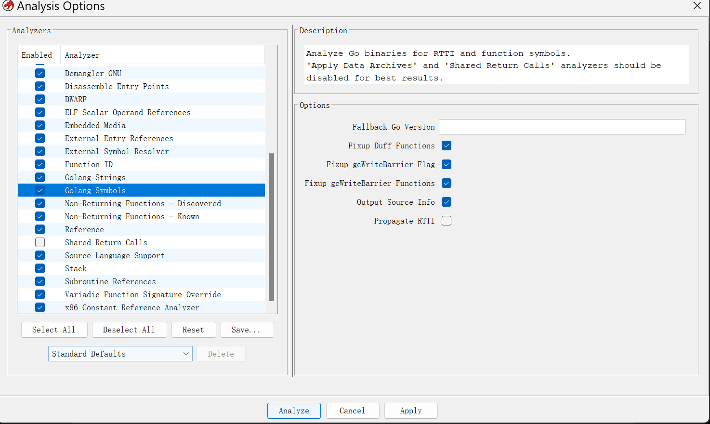
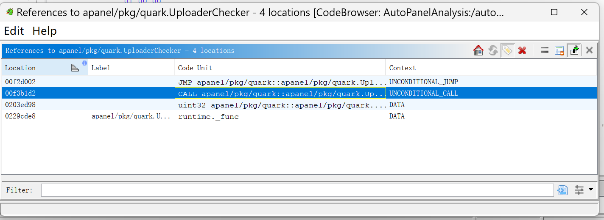
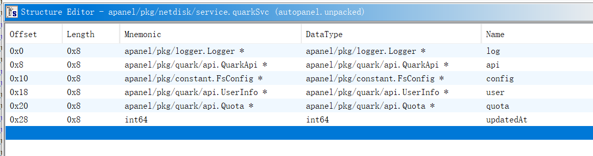
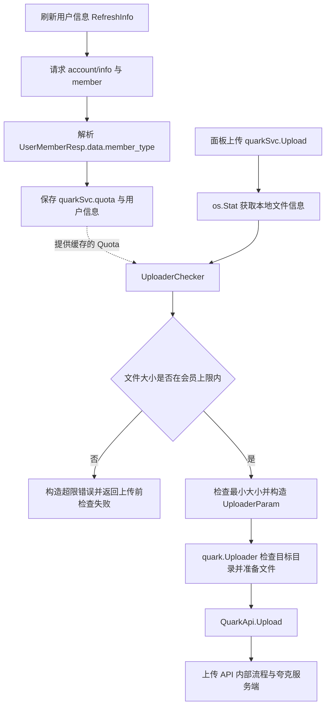

# 逆向 AutoPanel 夸克网盘上传逻辑并修复 4 GiB 限制

我在 AutoDL 实例中使用 AutoPanel 将模型文件上传到夸克网盘。账号通过 Cookie 认证，开通了 88VIP 联合会员，账号权益说明支持 200 GB 大文件；但一个约 10 GiB 的文件在 AutoPanel 中上传失败，小文件则可以成功。错误提示中同时出现了 `4.0 GiB` 和 `member_type:EXP_SVIP`。

在网页版 ChatGPT 的指导下，我提取了实例中的 AutoPanel 可执行文件，用 UPX 解压，再在 Windows 上通过 GoReSym 和 Ghidra 还原了会员信息到上传检查的调用链。最终发现：这个构建将会员上传上限写在本地程序中，`EXP_SVIP` 不在已识别的类型里，因而落入默认的 4 GiB 分支。

这篇文章按可以复现的顺序记录有效步骤。只想安装现成补丁，可直接阅读[安装、验证与回滚](install.md)；想继续修改其他参数，可配合[参数索引](parameters.md)阅读。原始记录的对应位置见[证据与构建记录](evidence.md)。

> **当前补丁的范围：** 仓库中的 `autopanel.unpacked` 将 `UploaderChecker()` 对未知会员类型的默认上限由 4 GiB 改为 **16 GiB**，同时修改了超限提示使用的常量。它没有新增 `EXP_SVIP` 分支，没有把上限改成 200 GB，也没有修改夸克服务端权限。原会话记录了约 10 GiB 文件开始正常上传；作者在后续整理时确认原实例问题已解决。这里不据此声称验证过 200 GB 文件。

## 一 从报错确定分析目标

最初的报错为：

```text
The maximum upload limit of your VIP level is 4.0 GiB,
file model_world_size_1_rank_0.pt size is 10 GiB,
member_type:EXP_SVIP
you can buy quark vip to increase upload size.
```

这段文字给了两个定位入口：英文错误字符串和会员类型。后面会看到，错误字符串确实由 AutoPanel 的 `UploaderChecker()` 构造。`EXP_SVIP` 是这个账号实际返回的值，但程序只收录了另外六种会员名称。

这里要分清 **GB** 与 **GiB**。本文分析的程序常量使用字节，换算为 GiB 时除以 `2^30`。用户侧权益说明中的 200 GB 不应直接替换为程序的 200 GiB。

## 二 找到运行文件并提取分析副本

### 确认可执行文件和服务管理方式

在 AutoDL 实例中通过独立 SSH 终端执行：

```bash
ps -eo pid,ppid,args | grep '[a]utopanel'
command -v autopanel
```

原实例的进程命令为：

```text
autopanel serve --work-dir=/root/autodl-tmp --cache-dir=/root/autodl-tmp
```

将查到的 PID 填入 `AP_PID`，确认进程实际运行的文件，而不只是检查 PATH 中的同名命令：

```bash
AP_PID=1234  # 替换为上一步查到的实际 PID
readlink -f /proc/"$AP_PID"/exe
sha256sum /proc/"$AP_PID"/exe
file /usr/bin/autopanel
supervisorctl -s unix:///tmp/supervisor.sock status autopanel
```

这次目标是 `/usr/bin/autopanel`，由 Supervisor 的 `autopanel` 任务管理。工作目录、缓存目录和可执行文件是不同的对象；用于这次逆向的是可执行文件，不需要复制账号 Cookie 或整个工作目录。

本文涉及三个文件状态，后文地址均以未修改的解压版为基准：

| 状态 | 字节数 | SHA-256 |
| --- | ---: | --- |
| 原始部署文件，UPX 压缩 | 35,309,480 | `fd3a94c9c0173df78b62703f26946559793e9a43365b335df57e0c270f8e16ed` |
| UPX 解压后，尚未修改 | 56,922,528 | `de4bdbd94c1c4f15d4fc29aa0a3b4506377b2d47e2e57a6bc684dc799fd15fc2` |
| 仓库中的 16 GiB 补丁 | 56,922,528 | `0c5add05dba0575411b3c8f43812e194c4c7ef3ea1003a8b36a6a196ad05547d` |

文件名同为 `autopanel.unpacked` 并不意味着内容相同，应以哈希区分。

### 使用 UPX 解压副本

这个构建经过 UPX 压缩。原操作使用 [UPX 5.3.0 官方 Linux amd64 版本](https://github.com/upx/upx/releases/tag/v5.3.0)。下面将工具下载、校验和副本解压合并为一段，任一步失败均应停止：

```bash
mkdir -p /root/autodl-tmp/goresym-analysis
cd /root/autodl-tmp/goresym-analysis

wget -O upx.tar.xz \
  https://github.com/upx/upx/releases/download/v5.3.0/upx-5.3.0-amd64_linux.tar.xz
echo '79cea8a50b6fa102d10c7b79a419cd77dead3cc2d78661de2dc5e5815dc505c1  upx.tar.xz' | sha256sum -c -
tar -xf upx.tar.xz

./upx-5.3.0-amd64_linux/upx -t /usr/bin/autopanel
cp -a /usr/bin/autopanel autopanel.unpacked
./upx-5.3.0-amd64_linux/upx -d autopanel.unpacked

file autopanel.unpacked
stat -c '%s' autopanel.unpacked
sha256sum autopanel.unpacked
```

测试输出包含 `testing /usr/bin/autopanel [OK]`，解压输出包含 `Unpacked 1 file.`。解压版恢复为 Linux x86-64 ELF，包含 Go 调试信息，解释器为 `/lib64/ld-linux-x86-64.so.2`。只解压副本，运行中的文件仍保持原样。

通过 JupyterLab 文件浏览器打开 `/root/autodl-tmp/goresym-analysis/`，右键下载 `autopanel.unpacked`。当时将它保存到 Windows 的 `D:\autodl\autopanel.unpacked`，随后核对：

```powershell
Get-FileHash 'D:\autodl\autopanel.unpacked' -Algorithm SHA256
```

结果应为上表中的 `de4b…15fc2`。

## 三 准备 Windows 分析工具

这次实际使用的组合是 Windows 11、Ghidra 12.2、Eclipse Temurin JDK 25.0.5 和 GoReSym。使用其他 Ghidra 版本时，按该版本的安装文档选择 JDK。

1. 从 [Temurin 下载页](https://adoptium.net/temurin/releases/?version=25)下载 Windows x64 JDK 25，安装后在新 PowerShell 中运行 `java -version`，确认使用 64 位 JDK。Ghidra 12.2 的要求见[官方 Getting Started](https://github.com/NationalSecurityAgency/ghidra/blob/Ghidra_12.2_build/GhidraDocs/GettingStarted.md)。
2. 从 [Ghidra 官方发布页](https://github.com/NationalSecurityAgency/ghidra/releases/tag/Ghidra_12.2_build)下载发行 ZIP。当时文件名为 `ghidra_12.2_PUBLIC_20261016.zip`，解压到 `D:\autodl\Ghidra`。
3. 从 [GoReSym 官方发布页](https://github.com/mandiant/GoReSym/releases)下载 Windows 版本，解压后得到 `D:\autodl\GoReSym\GoReSym.exe`。

Ghidra 用于阅读汇编和伪代码；GoReSym 用于提取 Go 函数名称、地址与类型。二者处理的是 Linux 可执行文件的数据，不需要在 Windows 中运行 AutoPanel。

### 先导出函数索引

原会话成功使用以下命令提取函数信息：

```powershell
Set-Location D:\autodl
.\GoReSym\GoReSym.exe -h
.\GoReSym\GoReSym.exe -v 1.24 .\autopanel.unpacked > .\autopanel-analysis.json

$analysis = Get-Content .\autopanel-analysis.json -Raw | ConvertFrom-Json
$analysis.UserFunctions |
    Where-Object { $_.FullName -match 'quark' -and
        $_.FullName -match 'MaxUploadSize|UploaderChecker|upPre' } |
    Select-Object Start, End, FullName
```

`-v 1.24` 是当时用于该构建的版本覆盖参数；它不是 AutoPanel 的发行版本号。[GoReSym 文档](https://github.com/mandiant/GoReSym#usage)说明，错误的版本覆盖会使类型解析失败或失真，换构建时不要直接沿用。

关键函数如下。这些是 ELF **虚拟地址**，不是文件偏移：

| 函数 | 入口地址 | 作用 |
| --- | --- | --- |
| `api.Quota.MaxUploadSize` | `0x00F1F240` | 值接收器的会员上限映射 |
| `api.(*Quota).MaxUploadSize` | `0x00F29EC0` | 指针接收器对应入口 |
| `quark.UploaderChecker` | `0x00F2CCA0` | 上传前大小检查 |
| `quark.Uploader` | `0x00F2D020` | 文件准备与实际上传调用 |
| `service.(*quarkSvc).Upload` | `0x00F3B100` | 面板上传业务入口 |
| `service.(*quarkSvc).RefreshInfo` | `0x00F3BB40` | 刷新用户和会员配额 |
| `service.(*quarkSvc).UserInfo` | `0x00F3BD20` | 用户信息缓存与刷新 |
| `api.(*QuarkApi).UserInfo` | `0x00F292C0` | 请求用户信息 |
| `api.(*QuarkApi).Quota` | `0x00F29640` | 请求会员与容量信息 |
| `api.(*QuarkApi).Upload` | `0x00F25120` | 上传 API 编排入口 |
| `api.(*QuarkApi).upPre` | `0x00F26380` | 构造预上传请求 |

表内省略了共同前缀 `apanel/pkg/`；`api` 对应 `quark/api`，`service` 对应 `netdisk/service`。完整名称见[函数索引 JSON](evidence/functions.json)。

## 四 在 Ghidra 中建立可阅读的分析结果

### 导入并执行自动分析

本机为 16 GB 内存，当时使用 8 GB Java 堆启动 Ghidra：

```powershell
$env:GHIDRA_GUI_MAXMEM = '8G'
& 'D:\autodl\Ghidra\ghidra_12.2_PUBLIC\ghidraRun.bat'
```

在 Ghidra 中依次操作：

1. **File → New Project → Non-Shared Project**，创建项目 `AutoPanelAnalysis`，项目目录使用 `D:\autodl\GhidraProjects`。
2. **File → Import File…**，选择未修改的 `D:\autodl\autopanel.unpacked`。
3. 核对 Format 为 ELF、Language 为 `x86:LE:64:default`。保留 ELF 导入器映射，不要按 Raw Binary 导入。
4. 双击项目中的程序，打开 CodeBrowser。出现分析提示时，进入 Analysis Options。
5. 保留 **Golang Symbols**、**Golang Strings**。在 Golang Symbols 的右侧选项里取消 **Propagate RTTI**，再点击 Analyze。这是本次成功使用的设置，适合避免全程序类型传播消耗过多内存。
6. 等待分析结束，保存项目。右侧 Decompiler 用于阅读伪代码，中间 Listing 用于核对实际指令。



截图来自原操作记录。若 Decompiler 或 Symbol Tree 被关闭，可以通过 **Window → Decompiler / Symbol Tree** 重新打开。

### 搜索函数与跳转地址

优先在 **Symbol Tree → Functions** 的 Filter 中搜索 `MaxUploadSize`、`UploaderChecker`、`RefreshInfo` 等名字。核对完整包路径，避免打开阿里云盘、百度网盘中的同名函数。

如果目标名称还未恢复，点击 Listing，按 **G**，输入上表地址，例如 `00F1F240`。在确认是代码的入口处，如果还没有定义指令，先按 **D** 反汇编，再按 **F** 创建函数。用源码注释 `/code/pkg/quark/api/basic.go:135`、反编译中的 `strings.ToLower` 和会员常量交叉核对位置。

`Search → Program Text…` 可用来搜索已显示的函数名或错误文字；`Search → for Strings…` 可用来寻找字符串数据，再查看引用。对于 Go 字符串，要结合指针和长度读取；搜不到完整字符串时，已恢复的函数名与函数索引通常更直接。

这里不需要把 `EXP_SVIP` 本身作为唯一搜索词：本次问题恰恰是程序没有收录它。搜索 `The maximum upload limit of your VIP level`，或直接打开 `UploaderChecker`，更容易找到检查位置。

### 通过交叉引用找到真实调用方

打开 `UploaderChecker`，在入口地址或函数名称上右键选择 **References → Show References To**，也可使用对应快捷键 **X**。原记录中有四个引用，真正的业务调用位于 `0x00F3B1D2`，类型为 `UNCONDITIONAL_CALL`。



双击这条 CALL，进入 `service.(*quarkSvc).Upload`，同时看调用前后的代码：

```text
os.Stat(本地路径)
  → UploaderChecker(fileInfo, self.quota)
  → 有错：记录 quark: upload check failed. 并返回 ErrBeforeUploadCheckFailed
  → 无错：检查文件最小大小，构造 UploaderParam，调用 quark.Uploader
```

引用列表中的跳回自身的 JMP 可属于 Go 栈扩展路径，DATA 则可能来自运行时元数据，不能把它们都当作业务调用者。

## 五 还原会员信息如何进入检查器

### 从服务器响应到 Quota

`api.(*QuarkApi).Quota()` 在 `/code/pkg/quark/api/user.go:51`，向配置的 API 基址加上 `/member` 发起 GET 请求。代码组装了 `fr`、`pr` 参数以及来自 `FsConfig.Cookie` 的 Cookie 请求头，随后把 JSON 响应解码到 `api.UserMemberResp`。

会员信息不是仅靠昵称或总容量推断出来的。响应里的 `data.member_type` 被复制到 `api.Quota.MemberType`，其他容量字段也分别复制到 `Quota`。与本次问题相关的类型可以整理为：

```go
// 从恢复的类型中节选，省略与本次判断无关的响应字段。
type Quota struct {
    SecretUseCapacity   uint64 `json:"secret_use_capacity"`
    SecretTotalCapacity uint64 `json:"secret_total_capacity"`
    UseCapacity         uint64 `json:"use_capacity"`
    TotalCapacity       uint64 `json:"total_capacity"`
    MemberType          string `json:"member_type"`
}
```

`MemberType` 位于 `Quota + 0x20`，在 amd64 上字符串由指针与长度组成，长度位于 `+0x28`。这个布局解释了检查器中对两个相邻机器字的访问，不能把它们误读为两个独立业务参数。

若希望直接导出 Go 类型，可以复用原会话中成功的方式，而无需手工推算整张字段表：

```powershell
Set-Location D:\autodl
.\GoReSym\GoReSym.exe -t -nofuncs .\autopanel.unpacked > .\autopanel-types.json
$types = Get-Content .\autopanel-types.json -Raw | ConvertFrom-Json
$types.Types |
    Where-Object { $_.Str -in @('api.UserMemberResp', 'api.Quota') } |
    ForEach-Object { $_.Reconstructed }
```

本次类型 JSON 约 559 MB，函数索引中未启用 `-t` 时 `Types` 为空。先确认工具帮助与输出结构，再按 `Str` 筛选。恢复出的完整字段节选见[结构体记录](evidence/quark-structs.txt)。

### RefreshInfo 保存会员信息

`service.(*quarkSvc).RefreshInfo()` 的有效业务顺序是：

1. 调用 `api.UserInfo()` 请求 `/account/info`；请求失败或昵称为空时返回错误。
2. 保存用户信息，再调用 `api.Quota()` 获取 `/member` 的会员与容量信息；失败时返回刷新错误。
3. 保存 `self.quota`，将其中的 `MemberType` 同步到 `self.user.MemberType`，把 `Quota` 对象挂到用户信息中。
4. 更新 `updatedAt`。

这里的 `self` 是业务服务对象 `quarkSvc`。它自己的 `+0x20` 保存的是 **Quota 指针**，和 `Quota` 内部 `+0x20` 的 **MemberType 字符串**是两层不同的偏移。



`quarkSvc.UserInfo()` 还存在一个 300 秒缓存判断：距 `updatedAt` 不到 300 秒时直接返回缓存，否则调用 `RefreshInfo()`。这不表示每次上传都会刷新会员信息，也不是定时后台刷新器。

## 六 还原上传大小判断与上传调用链

### 会员映射的等效逻辑

`Quota.MaxUploadSize()` 和 `UploaderChecker()` 的反编译结果中，都出现了相同的会员分支。以下是按业务语义重写的等效 Go 伪代码，**不是恢复出的原始 Go 源码**：

```go
func maxUploadSize(memberType string) int64 {
    switch strings.ToLower(memberType) {
    case "vip", "svip", "super_vip":
        return 100 << 30
    case "zvip", "svip+", "z_vip":
        return 200 << 30
    default:
        return 4 << 30
    }
}

func UploaderChecker(info os.FileInfo, quota *api.Quota) error {
    limit := maxUploadSize(quota.MemberType)
    if info.Size() <= limit {
        return nil
    }
    return errors.Errorf(
        "The maximum upload limit of your VIP level is %s, file %s size is %s, member_type:%v you can buy quark vip to increase upload size.",
        Humanize(limit), info.Name(), Humanize(info.Size()), quota.MemberType,
    )
}
```

这里用辅助函数消除了重复，便于阅读；实际二进制的 `UploaderChecker()` 内含会员分支，不能指望只修改独立的 `Quota.MaxUploadSize()` 就改变上传检查。它可能涉及编译内联，原始源码是否重复编写不能仅凭反编译结果确定。

| 转为小写后的类型 | 常量 | 字节数 | 上限 |
| --- | --- | ---: | ---: |
| `vip`、`svip`、`super_vip` | `0x1900000000` | 107,374,182,400 | 100 GiB |
| `zvip`、`svip+`、`z_vip` | `0x3200000000` | 214,748,364,800 | 200 GiB |
| 其他，包括 `exp_svip` | `0x100000000` | 4,294,967,296 | 4 GiB |

转小写只解决大小写差异，不会把 `exp_svip` 变成 `svip`。因此这个账号的约 10 GiB 文件会进入超限错误分支。比较使用 `<=`，等于上限可通过这项检查。

### 从面板到夸克请求

结合业务调用方和会员刷新函数，可以把本次已还原的主干画成下面这张图：



`quarkSvc.Upload()` 除会员上限外，还拒绝小于 `0xF` 即 **15 字节**的文件，返回 `ErrUploadMiniNumSizeLimit`。这项检查和大文件上限是不同规则。

`quark.Uploader()` 的原会话分析记录了目标目录同名文件检查、本地文件读取、MIME 类型和进度准备，然后把实际文件大小传给 `api.(*QuarkApi).Upload()`，最终记录成功或返回上传错误。当前提供的会话导出将它的完整代码保留为附件占位，所以这里只还原已经记录的调用主干，不补写其所有分支。

已经直接看到代码的 `api.(*QuarkApi).upPre()` 位于 `/code/pkg/quark/api/upload.go:201`，通过 `UploadRequest` 发送 `POST /file/upload/pre`。它创建的请求包含：

| 字段 | 本次代码中可确认的内容 |
| --- | --- |
| `file_name` | 上传文件名 |
| `size` | 文件字节数，以 int64 类型写入请求 |
| `pdir_fid` | 父目录 ID |
| `format_type`、`dir_name` | 格式与目录字段 |
| `l_created_at`、`l_updated_at` | 由当前时间生成的毫秒时间戳 |
| `ccp_hash_update` | 哈希更新标记 |

这段 `upPre()` 中没有会员等级到 4 / 100 / 200 GiB 的比较。它证明文件大小还会传给服务端，不能据此宣称服务端没有限制。原会话在定位本地故障后转入补丁验证，并未完成 `QuarkApi.Upload()` 内部所有分片、重试和完成确认分支的还原。

## 七 制作与核对 16 GiB 补丁

### 明确要修改哪两处

在 Ghidra 项目副本中打开 `UploaderChecker()`。第一处默认常量用于实际大小比较，第二处默认常量位于失败路径，用于错误信息。二者都从 `0x100000000` 改成 `0x400000000`，即由 4 GiB 调为 16 GiB。

本次整理时对本地未修改版和仓库补丁逐字节比较，结果如下：

| 作用 | 指令虚拟地址 | 指令文件偏移 | 改变的文件字节偏移 |
| --- | --- | --- | --- |
| 实际比较使用的默认值 | `0x00F2CD9B` | `0x00B2CD9B` | `0x00B2CDA1` |
| 错误信息使用的默认值 | `0x00F2CE77` | `0x00B2CE77` | `0x00B2CE7D` |

两处指令都是向 64 位 RAX 写入立即数的 10 字节指令：

```text
原版：48 b8 00 00 00 00 01 00 00 00    MOV RAX,0x100000000
补丁：48 b8 00 00 00 00 04 00 00 00    MOV RAX,0x400000000
```

整个文件只改变了上述两个字节，均为 `01 → 04`。此处地址到文件偏移的关系来自本构建的 ELF LOAD 段映射；不要把减去 `0x400000` 当作其他构建的通用规则。

### 在 Ghidra 中修改和导出

1. 在 Listing 按 **G** 跳到 `00F2CD9B`，核对原指令为 `MOV RAX,0x100000000`。
2. 右键 **Patch Instruction**，将立即数改为 `0x400000000`，核对修改后仍为 10 字节且寄存器仍为 RAX。
3. 跳到 `00F2CE77`，进行相同修改。
4. 回到 Decompiler，核对比较值与错误提示值都变成 16 GiB，其他会员分支仍为 100 / 200 GiB。
5. 在 CodeBrowser 的 **File → Export Program… / Export File…** 打开导出窗口，Format 选择 **Original File**；在 Options 中启用 **Export User Byte Modifications**。
6. 导出完整文件到 `D:\autodl\autopanel-test16g\autopanel.unpacked`，保留未修改版。Ghidra 的 [Original File 导出说明](https://github.com/NationalSecurityAgency/ghidra/blob/Ghidra_12.2_build/Ghidra/Features/Base/src/main/help/help/topics/ExporterPlugin/exporter.htm#original_file)说明了原文件布局和字节修改的导出行为。

输出必须是 ELF 可执行文件，不是反编译 C 文本或 Ghidra 项目。使用 Original File 可以保留这里所需的 ELF 布局。

### 核对导出文件

先计算 SHA-256；若复现同一补丁，结果应为 `0c5a…5547d`。也可以在本地 Python 中执行下面的核对，它只读取文件：

```python
from pathlib import Path
import hashlib

original = Path(r"D:\autodl\autopanel.unpacked").read_bytes()
patched = Path(r"D:\autodl\autopanel-test16g\autopanel.unpacked").read_bytes()
assert hashlib.sha256(original).hexdigest() == "de4bdbd94c1c4f15d4fc29aa0a3b4506377b2d47e2e57a6bc684dc799fd15fc2"
assert len(original) == len(patched) == 56922528
changes = [(i, a, b) for i, (a, b) in enumerate(zip(original, patched)) if a != b]
assert changes == [(0xB2CDA1, 1, 4), (0xB2CE7D, 1, 4)]
assert hashlib.sha256(patched).hexdigest() == "0c5add05dba0575411b3c8f43812e194c4c7ef3ea1003a8b36a6a196ad05547d"
print("两处常量修改与仓库补丁一致")
```

只改错误提示中的常量不会让文件通过检查；只改独立的 `Quota.MaxUploadSize()` 也不能覆盖已在 `UploaderChecker()` 中展开的分支。

## 八 部署并观察实际上传

把导出的**文件**上传到实例的 `/root/autopanel-test16g/autopanel.unpacked`。在 Linux 中确认文件格式、权限、哈希和动态依赖：

```bash
PATCH=/root/autopanel-test16g/autopanel.unpacked
file "$PATCH"
sha256sum "$PATCH"
chmod 755 "$PATCH"
ldd "$PATCH"
```

之后按照[安装页](install.md)使用仓库脚本完成备份、停止、替换和重启：

```bash
bash autopanel-fix.sh install /root/autopanel-test16g/autopanel.unpacked
```

切换时使用独立 SSH，保留原 Supervisor 服务与启动参数。AutoPanel 同时支撑网页文件管理，停止它会影响网页入口，因此不能依赖同一网页终端完成后续切换。

脚本验证运行中的 `/proc/<PID>/exe` 与补丁哈希一致之后，使用相同账号、相同目标目录、原来失败的文件复测。原会话在 2026 年 11 月 19 日 22:41 记录：约 10 GiB 文件已经开始正常上传，原来的 4 GiB 上传前拦截不再出现。

一次完整验证还应检查任务完成状态和远端文件字节数。这个实验验证了本地拦截的原因与两处常量补丁的作用；它没有建立所有会员类型或更大文件的服务端权限表。

## 九 把方法用到其他参数

这次逆向最有复用价值的是“从业务错误追到生效分支，再核对字段来源和真实调用方”的路线。修改新的参数时，可沿用以下顺序：

1. 保存目标文件哈希和运行入口，区分部署版、解压版与补丁版。
2. 用函数名、错误字符串或协议路径定位候选函数。
3. 查看交叉引用，找到真实业务 CALL，确认候选代码在目标操作中会执行。
4. 从类型信息确认参数含义，再核对常量单位、比较方向和边界。
5. 检查其他函数或内联代码中是否还有同一规则。显示值、实际检查值和服务端权限不能混为一谈。
6. 修改副本，比较机器码差异，部署后确认实际运行文件，并用目标输入验证结果。

除了会员大小上限，本次记录还定位到了 15 字节最小文件检查、300 秒用户信息缓存和 HTTP 客户端的一条 90 秒默认超时分支。它们的作用位置与验证状态见[参数索引](parameters.md)。其中 90 秒并不是所有请求的统一超时：代码还可能提前返回 `net/http.DefaultClient`，或接受显式传入的超时。

若未来修复会员兼容性，更合适的方向是核实 `EXP_SVIP` 的实际权益后补全会员映射，或使用服务端明确返回的权益字段，并使所有本地检查与展示保持一致。当前 16 GiB 补丁保留为这一构建上可复现的修复实验。
